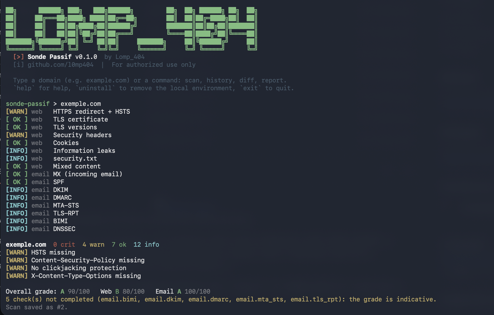

# Sonde Passif



**Passive web + email security audit**, from the command line (terminal only).

It only reads **public information**: HTTP headers, TLS certificate, DNS, email configuration (SPF,
DKIM, DMARC…). No penetration testing, no attacks, no port scanning: it behaves like a regular visitor.
It identifies itself with a recognizable User-Agent (`Sonde/0.1.0 (passive security audit)`).

Messages, findings, fixes and reports are **in English by default**; add `--lang fr` (or
`SONDE_LANG=fr`) to get them in French.

## Contents

1. [Supported systems](#supported-systems)
2. [Installation and first launch](#installation-and-first-launch)
3. [Usage](#usage) (interactive mode, commands, launcher options)
4. [What is checked](#what-is-checked)
5. [Grade and severity levels](#grade-and-severity-levels)
6. [Reports](#reports) (HTML, JSON, PDF)
7. [Removing the local environment](#removing-the-local-environment)
8. [Data and files](#data-and-files)
9. [Troubleshooting](#troubleshooting)
10. [Tool security](#tool-security) (anti-SSRF, pinned dependencies)
11. [Tests](#tests)
12. [Limitations](#limitations) · [Acceptable use](#acceptable-use) · [License](#license)

## Supported systems

| System | Status |
|---|---|
| **macOS** (Apple Silicon / Intel) | ✅ developed and tested |
| **Linux** (Debian, Ubuntu, Kali, Arch…) | ✅ work and tested |
| **Windows** | ⚠️ not supported natively → use **WSL2** (Ubuntu) |

Requirements: **Python 3.12 or newer** and Internet access. Nothing else to install by hand.

## Installation and first launch

```bash
git clone https://github.com/l0mp404/SONDE-PASSIVE-WEBSCAN.git
cd SONDE-PASSIVE-WEBSCAN
python3 sonde_passif.py        # or: ./sonde-passif
```

On **first launch**, the program checks:

1. the Python version (3.12+);
2. your system (macOS / Linux; warns on Windows);
3. the required modules: `typer`, `rich`, `httpx`, `httpcore`, `dnspython`, `cryptography`, `idna`,
   `certifi`, `jinja2` (listed in `requirements.txt`).

If any are missing, it offers to **create a local `.venv` environment inside the folder** and install
the modules there from `requirements.lock`: exact versions, **verified hashes**
(`pip install --require-hashes`). The prompt is `[Y/n]` (`[O/n]` in French); `y`, `yes`, `o` and `oui`
are all accepted. Nothing is installed on the rest of your system. It then restarts itself inside that
environment automatically, and does so on every later launch.

Once everything is validated, a marker file (`~/.config/sonde-passif/.setup_ok`) avoids repeating the
check every time. To run it again: `python3 sonde_passif.py --check`.

If `./sonde-passif` answers "permission denied": `chmod +x sonde-passif`.

## Usage

The banner is shown on **every launch**.

### Interactive mode (the simplest)

Launch without arguments, then type a domain:

```text
$ ./sonde-passif
sonde-passif > example.com                 # = scan example.com
sonde-passif > scan example.com --crtsh
sonde-passif > history example.com
sonde-passif > diff example.com
sonde-passif > report 1 -f html -o report.html
sonde-passif > help
sonde-passif > uninstall                   # removes the local environment (see below)
sonde-passif > exit
```

A bare domain name (containing a dot) is treated as `scan <domain>`.

> `scan`, `history`, `diff` and `report` only work **inside** this prompt, or after
> `./sonde-passif` / `python3 sonde_passif.py`. Typing `scan example.com` alone in your terminal gives
> "command not found": the shell does not know these commands.

### One-liners

```bash
./sonde-passif scan example.com                  # full audit (web + email)
./sonde-passif scan example.com --only email     # email only (or --only web)
./sonde-passif scan example.com --crtsh          # + public subdomains (crt.sh)
./sonde-passif scan example.com --dkim-selector s1   # adds a DKIM selector to test
./sonde-passif scan example.com --json           # pure JSON on stdout, no banner (scripts)
./sonde-passif scan example.com --no-save        # do not save in the history
./sonde-passif scan example.com --lang fr        # messages and findings in French
./sonde-passif history example.com [-n 50]       # scan history of a domain
./sonde-passif diff example.com                  # compares the last 2 scans: new / fixed
./sonde-passif report 1 -f html -o report.html   # report of scan #1 (see "Reports")
./sonde-passif --version
./sonde-passif --help
```

`python3 sonde_passif.py …` does exactly the same as `./sonde-passif …`.

### Launcher options

| Option | Effect |
|---|---|
| `--lang en` / `--lang fr` | language of messages, findings and reports (default: `SONDE_LANG`, otherwise English); accepted anywhere on the command line, and in the interactive prompt (applies for the rest of the session) |
| `--no-banner` | hides the banner (it is also hidden automatically with `--json`) |
| `--check` | runs the installation check again (Python, system, modules) then exits |
| `--no-venv` | does not use the local `.venv`, even if it exists |
| `--uninstall` | removes the local environment (see below) |
| `--purge-data` | with `--uninstall`: also deletes the history and configuration |
| `--yes` | with `--uninstall`: does not ask for confirmation |

### The `--crtsh` option

Adds the list of **subdomains visible in public certificates** (Certificate Transparency logs, via
crt.sh). With this option only crt.sh is contacted, not the target. Results are "info": they never
affect the grade.

## What is checked

**Web**

| Check | What it looks at |
|---|---|
| HTTPS redirect + HSTS | HTTP → HTTPS, `Strict-Transport-Security` header |
| TLS certificate | validity, days left, issuer, domain coverage, chain |
| TLS versions | obsolete protocols still accepted (TLS 1.0 / 1.1) |
| Security headers | CSP, clickjacking protection (`X-Frame-Options` / `frame-ancestors`), `X-Content-Type-Options`… |
| Cookies | `Secure`, `HttpOnly`, `SameSite` |
| Information leaks | chatty headers, meta generator, exposed CMS and versions |
| security.txt | presence of a security contact |
| Mixed content | HTTP resources in an HTTPS page |
| Public subdomains *(`--crtsh` option)* | names found in certificates |

**Email**

| Check | What it looks at |
|---|---|
| MX | receiving servers |
| SPF | record present and strict |
| DKIM | common selectors (+ `--dkim-selector`) |
| DMARC | policy (`none` / `quarantine` / `reject`) |
| MTA-STS, TLS-RPT | enforced encryption / TLS reports between mail servers |
| BIMI | brand logo in mail clients |
| DNSSEC | DNS zone signing |

## Grade and severity levels

Each finding is **critical**, **warning**, **info** or **OK**, and comes with a fix to apply.

- Each category (web, email) starts at 100; **−15** per critical finding, **−5** per warning,
  0 for info.
- The penalty of a single check is **capped at 30** points: one issue cannot sink the whole grade.
- The overall grade is the average of the audited categories.
- Scale: **A** ≥ 90 · **B** ≥ 75 · **C** ≥ 55 · **D** ≥ 35 · **E** ≥ 20 · **F** below.

## Reports

```bash
./sonde-passif report 1 -f html -o report.html   # HTML (default)
./sonde-passif report 1 -f json                  # JSON on stdout (or -o file.json)
./sonde-passif report 1 -f pdf  -o report.pdf    # PDF (see below)
./sonde-passif report 1 -f html --print-light    # light background, saves ink
```

The scan number is shown at the end of a scan and in `history`. The HTML report is self-contained (no
external resources) and uses a dark theme.

Language: findings are written at scan time, in the language of the scan. The fixed text of the report
follows `--lang` when given, otherwise the language of the scan. `diff` correctly compares two scans
made in different languages (it matches findings on the English title stored with each one).

### PDF export (optional)

```bash
.venv/bin/pip install --require-hashes -r requirements-pdf.lock   # installs weasyprint
brew install pango                                                # macOS only
```

Without it, HTML and JSON reports work normally. On first launch, the program simply tells you that
`weasyprint` is missing.

## Removing the local environment

```bash
./sonde-passif --uninstall                 # removes .venv + the marker (asks for confirmation)
./sonde-passif --uninstall --purge-data    # also deletes the scan history and configuration
./sonde-passif --uninstall --yes           # no confirmation
```

Or, in interactive mode: `uninstall` (or `uninstall --purge-data`).

- The program **first lists what it will delete** and asks for confirmation (`[y/N]`, or `[o/N]` in
  French).
- By default, **the scan history is kept**.
- As a safeguard, `--purge-data` only deletes folders named exactly `sonde-passif`.
- The **program folder itself is not deleted**: remove it by hand if you no longer want it.
- On the next launch, the first-run check starts again (and offers to recreate `.venv`).

## Data and files

| Item | Location |
|---|---|
| Scan history (SQLite, local) | `~/.local/share/sonde-passif/sonde.db` |
| First-launch marker | `~/.config/sonde-passif/.setup_ok` |
| Local environment | `SONDE-PASSIVE-WEBSCAN/.venv` |

Nothing is sent anywhere except to the audited targets (regular visitor requests, DNS) and, with
`--crtsh`, to crt.sh. Optional environment variables: `SONDE_DATA_DIR`, `SONDE_CONFIG_DIR`, `SONDE_DB`
(change the locations above), `SONDE_LANG` (default language).

Folder contents:

```text
SONDE-PASSIVE-WEBSCAN/
├── sonde_passif.py        launcher (banner, checks, interactive mode, uninstall)
├── sonde-passif           shortcut: ./sonde-passif …
├── requirements.txt       direct dependencies, exact versions (==)
├── requirements.lock      all dependencies, exact versions + hashes (installed by the launcher)
├── requirements-pdf.*     optional module (PDF export): pinned .txt + hashed .lock
├── requirements-dev.*     test dependencies: pinned .txt + hashed .lock
├── pytest.ini, tests/     automated tests
├── README.md
└── sonde/                 the program (checks, scoring, history, reports, i18n/)
```

## Troubleshooting

| Symptom | Solution |
|---|---|
| `scan: command not found` | `scan` is not a standalone command: `./sonde-passif scan example.com`, or launch `./sonde-passif` then type the domain |
| `permission denied` on `./sonde-passif` | `chmod +x sonde-passif` |
| "Python 3.12+ required" | install Python 3.12 or newer (macOS: `brew install python`) |
| "Missing modules" | answer `y` when offered to create `.venv`, or run `pip install --require-hashes -r requirements.lock` |
| "Target resolves to a non-public IP address" | the domain points to a private/local address: for safety, the site is not contacted (see [Tool security](#tool-security)) |
| "Database … uses an unknown schema" | database created by a pre-release version: move `~/.local/share/sonde-passif/sonde.db` aside or use `SONDE_DB` |
| "PDF export unavailable" | see [PDF export](#pdf-export-optional); HTML and JSON remain available |
| Empty web results, "Not compared" in `diff` | the site was unreachable during one of the scans: run it again |
| Reset everything | `./sonde-passif --uninstall --purge-data`, then launch again |

## Tool security

**Anti-SSRF.** Sonde never connects to a non-public IP address: loopback, private networks, link-local
(including `169.254.169.254`, cloud metadata), CGNAT, reserved, documentation or multicast ranges, in
IPv4 and IPv6 alike, including IPv6 addresses that embed an IPv4 one (IPv4-mapped `::ffff:a.b.c.d`,
6to4, Teredo, NAT64).

- Every HTTP connection goes through a dedicated httpx transport that resolves the name **only once**,
  refuses if **any** of the addresses is not public, then connects to the verified address (no second
  lookup, so DNS rebinding has no effect). The original name is used for SNI and the certificate.
- This applies to **every redirect hop**; redirects can only go to `http`/`https` on ports 80/443.
- The same rule applies to TLS connections (certificate, TLS versions) and to fetching the MTA-STS
  policy.
- Proxies set in the environment (`HTTPS_PROXY`…) are ignored: the guard must see the real target.
- If the target itself points to a private address, web checks are not run, the web category is not
  graded, and an "info" finding explains why; email (DNS) checks still run.

**Capped responses.** Home page: 2 MB; MTA-STS policy: 64 KB; crt.sh: 5 MB (streamed, cut beyond that)
and at most 10,000 names examined.

**Pinned dependencies.** `requirements.txt` pins the exact versions of direct dependencies;
`requirements.lock` pins the whole tree with SHA-256 hashes, and the launcher installs with
`--require-hashes`. To update: edit `requirements.txt`, then regenerate the lock (command at the top of
the file) with [uv](https://docs.astral.sh/uv/).

## Tests

```bash
.venv/bin/pip install --require-hashes -r requirements-dev.lock
.venv/bin/python -m pytest
```

No test contacts the Internet. They cover in particular the anti-SSRF guard (addresses, redirects,
ports, TLS, MTA-STS), the crt.sh cap, the database schema, and the completeness of the French catalog
(every message in the code must have a translation, with the same placeholders).

## Limitations

- Only the home page is analyzed (headers, cookies, content): areas behind a login are not covered.
- DKIM is looked up among common selectors (`--dkim-selector` to add one).
- It does not replace a penetration test or a code/architecture review; no finding does not prove there
  is no vulnerability.
- A report is a snapshot: configurations change, so run it regularly (`diff` shows the evolution).
- Windows only through WSL2.

## Acceptable use

Passive mode only accesses information that any visitor can obtain. It is still an audit tool: do not
use it to harass or monitor third parties, and comply with the law of your country. This README is not
legal advice.

## License

[MIT](LICENSE) © 2026 L0MP

*by Lomp_404 · github.com/l0mp404*
